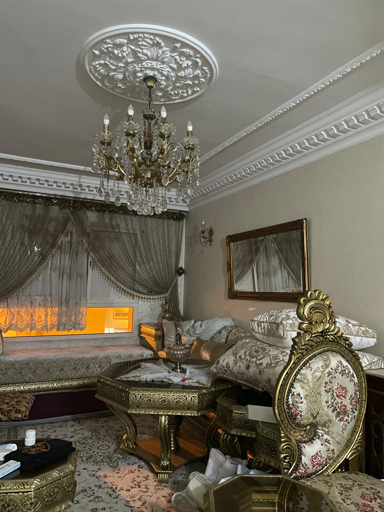
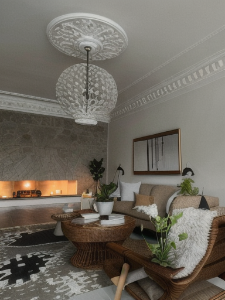

# Interior Redesign with Generative AI


Turns a photo of a cluttered room into a tidy, well-arranged version with a diffusion model
in *image-to-image* mode.

| Before | After |
|---|---|
|  |  |

The structure of the room is kept (ceiling rose and chandelier, mouldings, position of the
window, sofa, coffee table, armchair and wall frame), while the clutter disappears and the
style becomes cleaner.

## How it works

In image-to-image mode, the model does not start from pure noise. It adds a controlled amount
of noise to the **original photo**, then removes it step by step while following a text
prompt. The `strength` parameter sets how much noise is added, so how far the result can move
away from the photo.

## Model

`SG161222/Realistic_Vision_V5.1_noVAE`, a Stable Diffusion 1.5 variant optimised for
photorealism, used through `StableDiffusionImg2ImgPipeline`. It is not specialised in interior
design.

## Prompt strategy

**1. Positive prompt: describe the desired state, not another room.**

```
a clean and tidy living room, same layout, same furniture positions, everything organized,
minimalist scandinavian interior design, tidy shelves, indoor plants,
warm natural daylight from the window, interior design magazine photo,
photorealistic, highly detailed
```

The `same layout, same furniture positions` part is the most important: without it, the
model invents a completely different room instead of tidying the one in the photo.

The room also has to be named (`living room`): with only `room`, the model took the low sofa
along the wall for a bed and turned the living room into a bedroom.

**2. Negative prompt: name what must disappear.**

```
bed, bedroom, clutter, mess, scattered objects, laundry, boxes, cables, dirty,
blurry, low quality, deformed furniture, distorted perspective, watermark, text
```

`clutter, mess, scattered objects, laundry, boxes, cables` targets the actual clutter.
`bed, bedroom` prevents the sofa / bed confusion described above. On this task, the negative
prompt matters as much as the positive one.

**3. `strength`: the decisive parameter.**

| Value | Result |
|---|---|
| 0.60 | Unrecognisable room: different window, different furniture |
| **0.35** | Same ceiling, same chandelier, same window, tidy room |

Going from 0.60 to 0.35 is what made the result faithful to the original room.

**4. `guidance_scale = 8.0`**: follows the prompt without distorting the furniture.

## Settings used

| Parameter | Value |
|---|---|
| Image size | Resized to 512 px on the longest side, in multiples of 8 |
| `strength` | 0.35 |
| `guidance_scale` | 8.0 |
| `num_inference_steps` | 40 requested, **14 executed** (40 x 0.35) |
| Safety checker | Disabled (it returns black images by mistake on ordinary photos) |

## Running on CPU

No GPU required. Measured times:

| Step | Duration |
|---|---|
| Model download and loading | about 145 s (once, then cached) |
| Generation (14 effective steps) | about 140 s |

```bash
pip install -r requirements.txt
```

Open `exercise_4.ipynb` and run the cells. The notebook saves `before.png` and `after.png`.

## Project structure

```
exercise_4.ipynb     notebook with all steps and outputs
living_room.jpeg     original photo
before.png           resized input
after.png            generated result
requirements.txt     dependencies
```

## Notes and limitations

- No random seed is set: each run produces a different result. If the room drifts too far
  from the original, run the cell again or lower `strength` to 0.30.
- Image-to-image does not control the geometry precisely, so furniture can be slightly
  deformed. A ControlNet model, which adds a structural constraint such as edges or depth,
  would preserve it better.
- The resolution is limited to 512 px.
