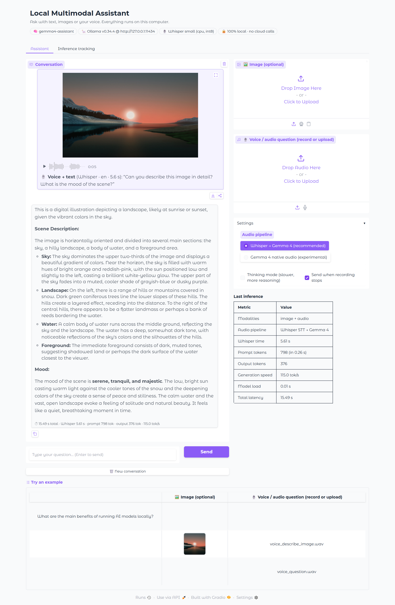
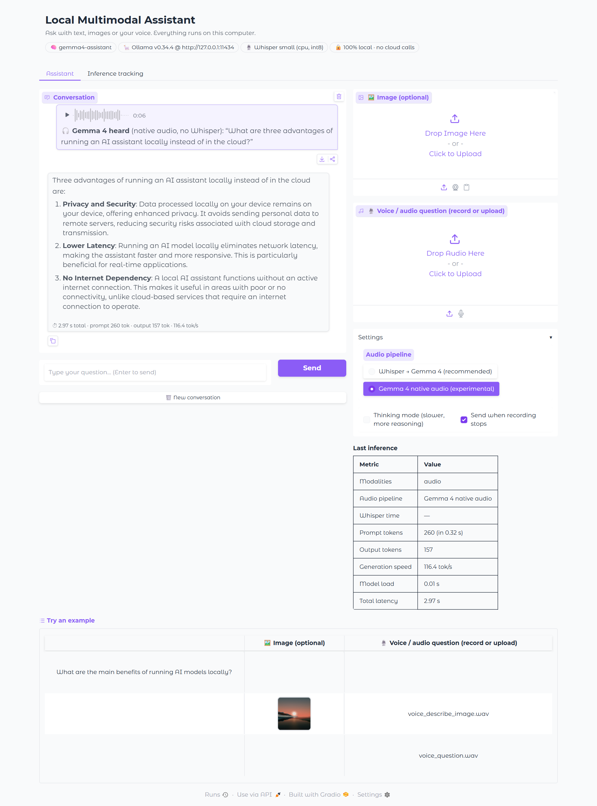
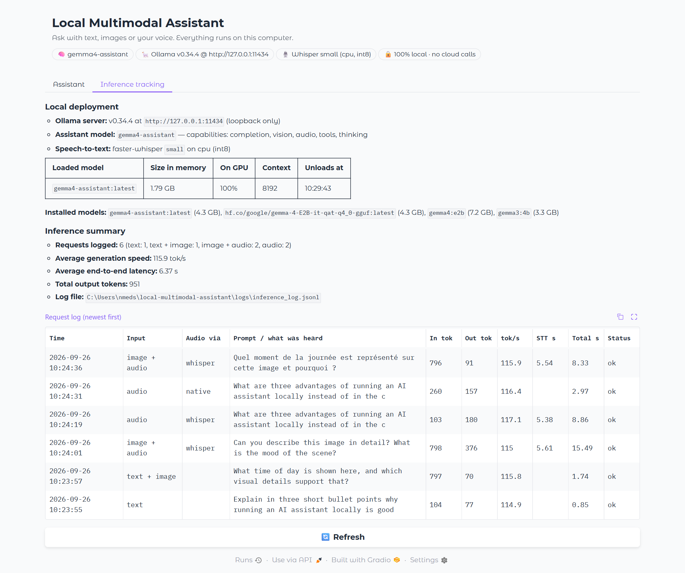

# Local Multimodal AI Assistant (Ollama + Gemma 4 + Whisper)


A private assistant that runs entirely on the local machine and accepts **text**, **images**
and **voice / audio**. No cloud API is used: Ollama listens on `127.0.0.1:11434`, the web UI
on `127.0.0.1:7860`, Gradio analytics are disabled and Whisper loads from the local cache.

Developed and tested on a Windows laptop with an RTX 4070 (8 GB VRAM).



## Features

- **Three input modalities:** text, images (upload, webcam, clipboard) and voice (file or
  microphone).
- **Two audio routes:** Whisper then Gemma 4 (default), or Gemma 4 native audio.
- **Multilingual voice:** Whisper detects the language (tested in English and French).
- **Inference tracking:** tokens, tokens per second, prompt evaluation, model load, Whisper
  time and latency for each request, in a JSONL log and in a tab of the UI.
- **Web UI and command line:** `app.py` and `cli.py`.
- **Automated tests:** 21 unit tests and 5 integration tests.

## Architecture

```
 text ─────────────────────────────┐
 image ──► normalise (JPEG ≤1600px)─┼──► Ollama /api/chat ──► gemma4-assistant (Gemma 4 E2B, GPU)
 voice ─┬► faster-whisper (local) ──┘        │                      │
        └► 16 kHz WAV (native audio) ────────┘                      ▼
                                     inference tracking ──► logs/inference_log.jsonl + UI tab
```

| Input | Route |
|---|---|
| Text | Sent as is |
| Image (upload, webcam, clipboard) | Normalised to an RGB JPEG and sent in `images` |
| Voice (audio file or microphone) | **Whisper then Gemma 4** (default): `faster-whisper small` transcribes locally and the transcript is the question. **Gemma 4 native audio**: resampled to 16 kHz mono WAV and given to Gemma 4's own audio encoder, which replies `Heard: …` then answers |

## Setup

### 1. Ollama

Ollama **v0.34.4** is installed (`%LOCALAPPDATA%\Programs\Ollama`) and serves on the loopback
address only.

### 2. Gemma 4

```bash
ollama pull hf.co/google/gemma-4-E2B-it-qat-q4_0-gguf   # Google's official Gemma 4 E2B (QAT Q4_0) + vision/audio projector
ollama create gemma4-assistant -f Modelfile             # recommended sampling + 8k context
```

`ollama show gemma4-assistant` reports the capabilities **completion, vision, audio, tools,
thinking**. The model runs 100 % on the GPU at about 110 to 120 tokens per second.

> **Known issue found during setup.** On Ollama 0.34.4 (Windows), the library tag
> `gemma4:e2b` handles text and audio correctly but returns nonsense for images: its bundled
> vision weights are converted at load time (`handle_gemma4_clip … translating` in
> `server.log`). The same prompt works with `gemma3:4b` and with Google's GGUF above, which
> ships a native projector.

### 3. Python environment

```bash
py -3.11 -m venv .venv && .venv\Scripts\pip install -r requirements.txt
```

## Usage

```bash
.venv\Scripts\python app.py                    # web UI at http://127.0.0.1:7860
.venv\Scripts\python cli.py --image samples\sunset_lake.jpg --audio samples\voice_describe_image.wav
.venv\Scripts\python cli.py -i                 # interactive: /image PATH, /audio PATH
```

### Configuration

Settings are read from environment variables:

| Variable | Role |
|---|---|
| `ASSISTANT_MODEL` | Ollama model name |
| `ASSISTANT_NUM_CTX` | Context size |
| `WHISPER_MODEL` | Whisper size (for example `base` is faster) |
| `WHISPER_DEVICE` | Device used by Whisper |
| `OLLAMA_HOST` | Address of the Ollama server |

## Tests

```bash
.venv\Scripts\python -m pytest                        # 21 unit + 5 integration tests (26 pass)
.venv\Scripts\python scripts\capture_screenshots.py   # re-creates screenshots/ (app must be running)
```

## Results

The voice clips in `samples/` were generated with the offline Windows speech synthesizer
(`scripts/make_voice_samples.ps1`), so the tests are reproducible; the microphone button of
the UI works the same way. The screenshots were taken by Playwright driving the real UI in
Edge (files are uploaded through the page, and the chat panel is expanded to full height for
the capture).

| # | Interaction | Result |
|:-:|---|---|
| 01 | Text question | 3-bullet answer, 0.85 s |
| 02 | Image + typed question | "sunrise or sunset", low sun, warm hues, 1.74 s |
| 03 | **Voice asks to describe a local image** (Whisper) | Exact transcript + detailed description and mood, 15.5 s |
| 04 | Voice-only question (Whisper) | Exact transcript + answer, 8.9 s |
| 05 | Voice-only question (Gemma 4 native audio) | "Gemma 4 heard: …" + answer, 3.0 s |
| 06 | French voice question about the image | Whisper detects `fr`, answer in French, 8.3 s |
| 07 | Inference tracking tab | Ollama status (model 100 % on GPU), summary, request log |




Whisper `small` takes about 5 s per 5-s clip on this laptop's CPU while the GPU is busy
(thermal sharing); the native audio mode avoids that step. Whisper on GPU needs the NVIDIA
cuBLAS / cuDNN 12 libraries.

## Project structure

```
app.py                          web UI (Gradio)
cli.py                          command line
Modelfile                       sampling settings and context size
assistant/
  config.py                     settings
  core.py                       routing and streaming
  speech.py                     Whisper transcription and audio preparation
  tracking.py                   per-request metrics
samples/                        test image and voice clips
screenshots/                    result screenshots
scripts/                        screenshot capture, voice sample generation
tests/                          unit and integration tests
requirements.txt, pytest.ini
```
