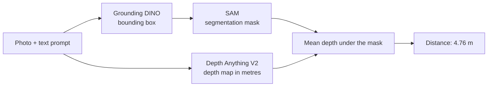

# Object Detection, Segmentation and Depth Estimation


A spatial perception pipeline that chains three models to locate an object described in
natural language, segment it precisely, then estimate its distance from the camera.

| 1. Detection | 2. Segmentation | 3. Depth |
|---|---|---|
|  |  |  |

Scene: a living room. Prompt: `"a chandelier."`

```
score : 0.84
distance camera - objet : 4.76 m
```

## Pipeline



| Step | Model | Role |
|:-:|---|---|
| 1 | **Grounding DINO** (`grounding-dino-tiny`) | Detects the object from a text prompt (zero-shot) |
| 2 | **SAM** (`sam-vit-base`) | Turns the box into a precise mask |
| 3 | **Depth Anything V2** (`Metric-Indoor-Small`) | Estimates the distance in metres |

The box produced by Grounding DINO is used as the prompt for SAM: this is what tells it
*what* to segment.

## Key point: the distance is measured on the mask

```python
distance = depth[mask].mean()
```

and not on the bounding box. In this image, **45 % of the box is not the chandelier**
(ceiling, mouldings). Using the box would shift the measurement by several tens of
centimetres. This is exactly the role of SAM in this pipeline.

## Choice of the depth model

The assignment allows MiDaS or Depth Anything. MiDaS goes through `torch.hub`, which loads a
second repository and **asks for an interactive keyboard confirmation**. This blocks the
automatic execution of a notebook with `EOFError`. Depth Anything goes through
`transformers`, without this dependency.

The *metric* variant returns a true depth (low value = close), unlike the relative variant,
which returns an inverse depth.

## Getting started

Python 3.11, on CPU.

```bash
pip install -r requirements.txt
```

`transformers` is pinned to version 5.15.1: the Grounding DINO post-processing API has
changed across versions.

Open `exercise_3.ipynb` and run the cells. The models are downloaded on the first run
(about 1 GB in total).

## Project structure

```
exercise_3.ipynb     notebook with all steps and outputs
living_room.jpeg     input scene
box.png              detection result
mask.png             segmentation result
depth.png            depth map
requirements.txt     dependencies
```

## Limitations

- The distance is an **estimate** from a monocular model, not a measurement. It can be
  checked against a real measurement with a tape measure.
- It is the depth along the camera axis, not necessarily the straight-line distance.
- SAM proposes three candidate masks for a box and the first one is used.
- The `tiny` version of Grounding DINO may miss small or unusual objects.
