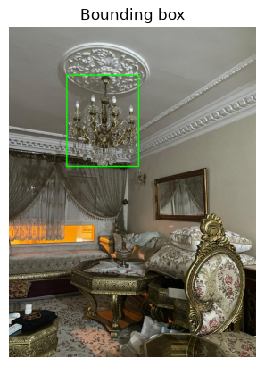
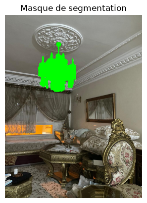
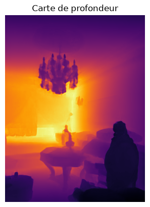

# Object Detection, Segmentation and Depth Estimation

A spatial perception pipeline chaining three models to locate an object described
in natural language, segment it precisely, then estimate its distance from the
camera.

## Pipeline

| Step | Model | Role |
|---|---|---|
| 1 | **Grounding DINO** (`grounding-dino-tiny`) | detects the object from a text prompt |
| 2 | **SAM** (`sam-vit-base`) | turns the box into a precise mask |
| 3 | **Depth Anything V2** (`Metric-Indoor-Small`) | estimates the distance in metres |

The box produced by Grounding DINO is used as the prompt for SAM: this is what tells
it *what* to segment.

## Result

Scene: a living room. Prompt: `"a chandelier."`

```
score : 0.84
distance camera - objet : 4.76 m
```

| 1. Detection | 2. Segmentation | 3. Depth |
|---|---|---|
|  |  |  |

## Key point: the distance is measured on the mask

```python
distance = depth[mask].mean()
```

and not on the bounding box. In this image, **45 % of the box is not the
chandelier** (ceiling, mouldings). Using the box would shift the measurement by
several tens of centimetres. This is exactly the role of SAM in this pipeline.

## Choice of the depth model

The assignment allows MiDaS or Depth Anything. MiDaS goes through `torch.hub`, which
loads a second repository and **asks for an interactive keyboard confirmation**.
This blocks the automatic execution of a notebook with `EOFError`.
Depth Anything goes through `transformers`, without this dependency.

Note: the *metric* variant returns a true depth (low value = close), unlike the
relative variant, which returns an inverse depth.

## Running

Python 3.11, on CPU.

```
pip install -r requirements.txt
```

`transformers` is pinned to version 5.15.1: the Grounding DINO post-processing API
has changed across versions.

Open `exercise_3.ipynb` and run the cells. The models are downloaded on the first
run (~1 GB in total).
