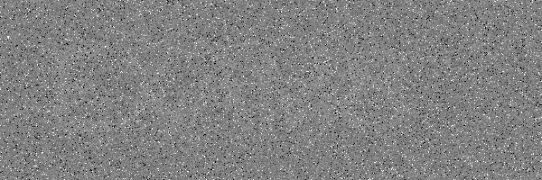
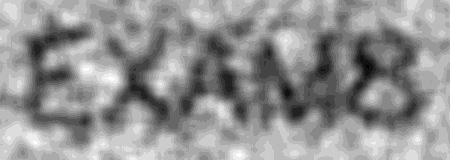
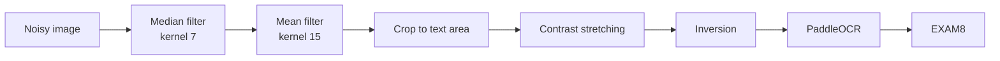

# Noisy Image Cleaning and OCR Text Extraction


Recovers a word hidden in a heavily noisy image with classical image processing, then reads
it automatically with an OCR engine.

**Result: `EXAM8`, confidence 0.99.**

| Original image | Cleaned image |
|---|---|
|  |  |

## The problem

The input image contains a word that is invisible to the naked eye, buried under two
different kinds of noise:

| Measure | Value | Meaning |
|---|---|---|
| Pixels at 0 and at 255 | 2.48 % and 2.58 % | **Impulse** noise (salt and pepper) |
| Standard deviation outside impulses | 19.88 | **Gaussian** noise |
| Text / background difference | only about **6 grey levels** | Very low contrast |

## Pipeline



The order of the filters follows from the nature of the noise.

| Step | Operation | Why |
|:-:|---|---|
| 1 | **Median filter** (kernel 7) | Non-linear: it *removes* isolated pixels at 0 and 255 instead of spreading them like a Gaussian blur would |
| 2 | **Mean filter** (kernel 15) | Smooths the remaining Gaussian noise |
| 3 | **Cropping** | Keeps the text area and drops the borders, where the filters leave artefacts |
| 4 | **Contrast stretching** (`normalize`) | Essential: with only 6 grey levels of difference, a threshold applied directly cuts the noise, not the text |
| 5 | **Inversion** | Dark text on a light background, the format expected by the OCR |
| 6 | **PaddleOCR** | Automatic text extraction |

## Result

```
['EXAM8'] [0.9908405542373657]
```

The notebook keeps the outputs of its execution: each cleaning step is displayed, up to the
OCR result.

## Getting started

Python 3.11, on CPU.

```bash
pip install -r requirements.txt
```

Open `exercise_1.ipynb` in VS Code or Jupyter and run the cells. The first run downloads the
PaddleOCR models.

## Project structure

```
exercise_1.ipynb     notebook with all steps and outputs
noisy_image.png      input image
figure_cleaned.png   cleaned image given to the OCR
requirements.txt     dependencies
```

## Notes

- **Windows:** the following line is required **before** importing PaddleOCR, otherwise the
  engine crashes with an internal error (oneDNN bug):

  ```python
  os.environ['FLAGS_use_mkldnn'] = '0'
  ```

- **Limitations:** the kernel sizes (7 and 15) are tuned for the noise level of this image and
  would have to be adjusted for another one. The 15x15 mean filter blurs the edges of the
  letters, which is acceptable here because the letters are large.
